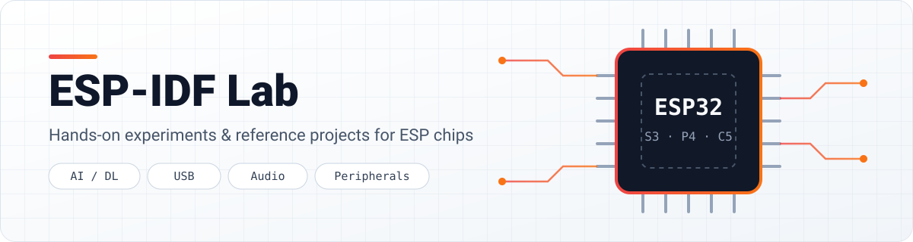
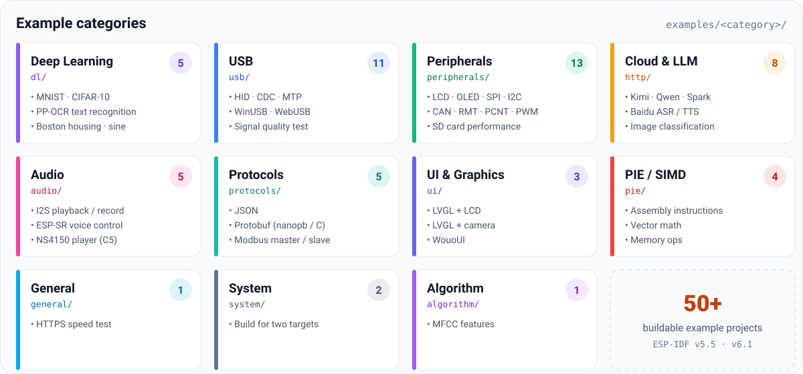

<p align="center">
  <picture>
    <source media="(prefers-color-scheme: dark)" srcset="docs/images/banner-dark.svg">
    
  </picture>
</p>

<p align="center">
  <a href="https://github.com/YanKE01/esp_demos/actions/workflows/build.yml"></a>
  
  
  
</p>

<p align="center">
  <b>English</b> | <a href="README_CN.md">简体中文</a>
</p>

`esp-idf-lab` is a collection of practical experiments and reference projects for learning ESP chip features with ESP-IDF. Every example is a standalone ESP-IDF project that you can build and flash on its own.

<p align="center">
  <picture>
    <source media="(prefers-color-scheme: dark)" srcset="docs/images/categories-dark.svg">
    
  </picture>
</p>

## Quick Start

```bash
# 1. Set up ESP-IDF (v5.5 or v6.1), then pick an example
. $IDF_PATH/export.sh
cd examples/peripherals/gpio/gpio_flip

# 2. Choose the target chip, build, flash and monitor
idf.py set-target esp32s3
idf.py build flash monitor
```

Examples that need extra setup (Wi-Fi credentials, API keys, wiring) have their own `README.md` in the example directory or category directory.

## Supported Chips

| Chip | ESP-IDF | Typical examples |
| --- | --- | --- |
| ESP32-S3 | v5.5 | Most examples: DL, audio, HTTP/LLM, peripherals, protocols, UI, USB |
| ESP32-P4 | v5.5 / v6.1 | SD card performance, USB MTP, USB host signal quality, HTTPS speed test |
| ESP32-C5 | v5.5 | NS4150 audio player |
| ESP32-S31 | v6.1 | USB host signal quality |

The exact target list built by CI is in [`build_config.yml`](build_config.yml).

## Project Capabilities

### 🧠 Deep Learning & AI (`dl`, `algorithm`)
- **Image Classification:** Categorize images (e.g., CIFAR10, MNIST) using TensorFlow Lite Micro.
- **OCR:** Text recognition with PP-OCR.
- **Data Prediction:** Perform regression and prediction tasks like Boston Housing pricing and Sine wave prediction using TFLite.
- **Audio Processing:** Extract MFCC (Mel-frequency cepstral coefficients) features from audio, and implement voice-activated lighting using the ESP-SR library.

### 🌐 Network & Cloud API (`http`, `general`)
- **LLM Integration:** Connect deeply with various Large Language Models via HTTP APIs, including Moonshot Kimi, Aliyun Tongyi Qianwen, Xunfei Xinghuo, and a general ESP GPT example.
- **Baidu Cloud Services:** Practical integrations for Baidu Access Token retrieval, Image Classification, Speech Recognition, and Text-to-Speech (TTS).
- **Networking:** HTTPS throughput test.

### 🔉 Audio Control (`audio`)
- **I2S Audio Playback:** Implement real-time audio playback using I2S amplifiers like MAX98357A and NS4150.
- **Recording & Storage:** Record audio via I2S microphone (e.g., MSM261S4030H0) and save it directly to an SD Card.

### 🔌 USB Protocol Stack (`usb`)
- **USB Device Emulation:** Emulate devices like HID Keyboard, HID Audio Control, native CDC ACM (Virtual COM Port) and MTP, and detect whether the host is Windows or Linux/macOS from its enumeration behaviour.
- **USB Data Transfer:** Implement custom bulk transfers, WinUSB (no composite), and WebUSB.
- **USB Host:** Mass storage (MSC) host.
- **Signal Quality:** USB device and host signal quality (eye diagram) test firmware.

### 💡 Hardware & Peripherals (`peripherals`)
- **LCD Displays:** Drive LCD/OLED screens and parse JPEG images from SPIFFS to display them.
- **PWM & Control:** Generate complementary PWM signals and calculate PWM information.
- **Communication Buses:** Drive common protocols like CAN, I2C, SPI, and GPIO high-speed flipping (up to 8MHz on S3).
- **Signal Control:** Utilize RMT (including WS2812) and PCNT.
- **Storage:** SD card (SDMMC) read/write performance test.

### 📜 Data Protocols (`protocols`)
- **Serialization:** Parse and handle JSON data, Protobuf (using nanopb), and Protobuf-C.
- **Industrial Protocols:** Implement Modbus serial master and slave.

### 🖥️ UI & Graphics (`ui`)
- **LVGL Integration:** Create graphical user interfaces using LVGL, including examples combining LCD and camera.
- **Custom UI:** Projects like `wououi`.

### ⚙️ System & Core (`pie`, `system`)
- **Processor Instruction Extensions (PIE):** Examples covering assembly instructions, math, and memory operations on the core.
- **Build System:** Advanced CMake features like building for two targets (`build_two_target`).

## Repository Layout

```text
esp_demos/
├── examples/          # One folder per category, one ESP-IDF project per example
├── components/        # Shared drivers (ssd1306, st7789)
├── tools/ci/          # CI helper scripts
├── docs/images/       # README images
└── build_config.yml   # Which examples CI builds for which chip / IDF version
```
