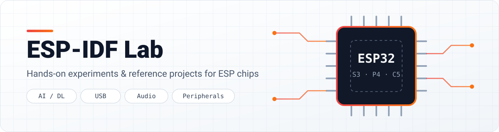
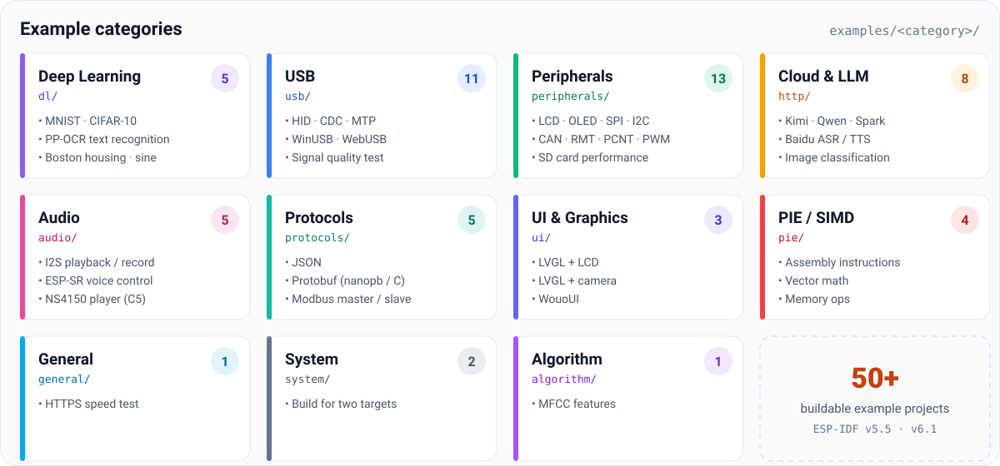

<p align="center">
  <picture>
    <source media="(prefers-color-scheme: dark)" srcset="docs/images/banner-dark.svg">
    
  </picture>
</p>

<p align="center">
  <a href="https://github.com/YanKE01/esp_demos/actions/workflows/build.yml"></a>
  
  
  
</p>

<p align="center">
  <a href="README.md">English</a> | <b>简体中文</b>
</p>

`esp-idf-lab` 是一个基于 ESP-IDF 的实践项目集合，包含用于学习 ESP 系列芯片功能的实验和参考实现。每个示例都是独立的 ESP-IDF 工程，可以单独编译和烧录。

<p align="center">
  <picture>
    <source media="(prefers-color-scheme: dark)" srcset="docs/images/categories-dark.svg">
    
  </picture>
</p>

## 快速开始

```bash
# 1. 配置好 ESP-IDF（v5.5 或 v6.1），然后进入任意示例
. $IDF_PATH/export.sh
cd examples/peripherals/gpio/gpio_flip

# 2. 选择目标芯片，编译、烧录并打开串口监视器
idf.py set-target esp32s3
idf.py build flash monitor
```

需要额外配置（Wi-Fi 账号、API Key、硬件接线）的示例，在示例目录或分类目录下有单独的 `README.md`。

## 支持的芯片

| 芯片 | ESP-IDF | 典型示例 |
| --- | --- | --- |
| ESP32-S3 | v5.5 | 大部分示例：深度学习、音频、HTTP/大模型、外设、协议、UI、USB |
| ESP32-P4 | v5.5 / v6.1 | SD 卡性能测试、USB MTP、USB 主机信号质量测试、HTTPS 速度测试 |
| ESP32-C5 | v5.5 | NS4150 音频播放 |
| ESP32-S31 | v6.1 | USB 主机信号质量测试 |

CI 实际编译的芯片与示例列表见 [`build_config.yml`](build_config.yml)。

## 项目能力

### 🧠 深度学习与人工智能（`dl`、`algorithm`）

- **图像分类：** 使用 TensorFlow Lite Micro 对图像进行分类，例如 CIFAR10 和 MNIST。
- **文字识别：** 使用 PP-OCR 进行文字识别。
- **数据预测：** 使用 TFLite 完成回归和预测任务，例如波士顿房价和正弦波预测。
- **音频处理：** 从音频中提取 MFCC（梅尔频率倒谱系数）特征，并使用 ESP-SR 实现语音控制灯光。

### 🌐 网络与云 API（`http`、`general`）

- **大语言模型集成：** 通过 HTTP API 接入 Moonshot Kimi、阿里云通义千问、讯飞星火等大语言模型，并提供通用的 ESP GPT 示例。
- **百度云服务：** 提供获取 Access Token、图像分类、语音识别和文本转语音（TTS）等实用集成示例。
- **网络：** HTTPS 吞吐量测试。

### 🔉 音频控制（`audio`）

- **I2S 音频播放：** 使用 MAX98357A、NS4150 等 I2S 功放实现实时音频播放。
- **录音与存储：** 通过 I2S 麦克风（例如 MSM261S4030H0）录制音频，并将其保存到 SD 卡。

### 🔌 USB 协议栈（`usb`）

- **USB 设备模拟：** 模拟 HID 键盘、HID 音频控制器、原生 CDC ACM（虚拟串口）和 MTP 等设备，并通过主机的枚举行为识别主机是 Windows 还是 Linux/macOS。
- **USB 数据传输：** 实现自定义批量传输、非复合设备 WinUSB 和 WebUSB。
- **USB 主机：** 大容量存储（MSC）主机。
- **信号质量：** USB 设备端与主机端信号质量（眼图）测试固件。

### 💡 硬件与外设（`peripherals`）

- **LCD 显示：** 驱动 LCD/OLED 屏幕，并解析、显示存储在 SPIFFS 中的 JPEG 图像。
- **PWM 与控制：** 生成互补 PWM 信号并计算 PWM 参数。
- **通信总线：** 驱动 CAN、I2C、SPI 等常用总线，并实现 GPIO 高速翻转（ESP32-S3 上最高可达 8 MHz）。
- **信号控制：** 使用 RMT（包括 WS2812）和 PCNT 外设。
- **存储：** SD 卡（SDMMC）读写性能测试。

### 📜 数据协议（`protocols`）

- **序列化：** 解析和处理 JSON、Protobuf（使用 nanopb）以及 Protobuf-C 数据。
- **工业协议：** 实现 Modbus 串口主机与从机。

### 🖥️ UI 与图形（`ui`）

- **LVGL 集成：** 使用 LVGL 创建图形用户界面，包括 LCD 与摄像头结合的示例。
- **自定义 UI：** 提供 `wououi` 等自定义 UI 项目。

### ⚙️ 系统与内核（`pie`、`system`）

- **处理器指令扩展（PIE）：** 提供汇编指令、数学运算和内存操作等示例。
- **构建系统：** 展示同时构建两个目标芯片等高级 CMake 用法（`build_two_target`）。

## 仓库结构

```text
esp_demos/
├── examples/          # 按分类组织，每个示例是一个独立的 ESP-IDF 工程
├── components/        # 公共驱动（ssd1306、st7789）
├── tools/ci/          # CI 辅助脚本
├── docs/images/       # README 图片
└── build_config.yml   # CI 针对各芯片 / IDF 版本编译哪些示例
```
